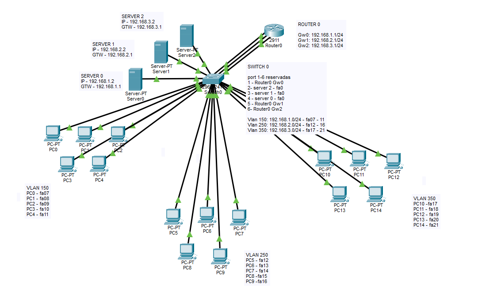

# Laboratório de Redes: VLANs, DHCP e Roteamento

Este projeto demonstra uma rede segmentada em três VLANs, com servidores DHCP e roteamento entre sub-redes por meio de um roteador Cisco 2911.

## Topologia

O switch central conecta 15 PCs, três servidores e o roteador. Cada grupo de clientes pertence a uma VLAN e a uma sub-rede IPv4 específica.

## Objetivos

- Separar os dispositivos em domínios de broadcast distintos por meio de VLANs.
- Distribuir endereços IP automaticamente por DHCP.
- Definir um gateway para cada sub-rede.
- Permitir comunicação entre redes diferentes por roteamento de camada 3.
- Documentar a organização física e lógica da rede.

## Equipamentos

| Equipamento | Quantidade | Função |
|---|---:|---|
| Cisco 2960-24TT | 1 | Comutação e segmentação por VLAN |
| Cisco 2911 | 1 | Gateway das três sub-redes e roteamento |
| Servidores | 3 | Serviços DHCP destinados às redes do laboratório |
| PCs | 15 | Clientes distribuídos entre as VLANs |

## Segmentação por VLAN

| VLAN | Sub-rede | Gateway | Clientes | Portas do switch indicadas |
|---|---|---|---|---|
| VLAN 150 | `192.168.1.0/24` | `192.168.1.1` | PC0–PC4 | Fa0/7–Fa0/11 |
| VLAN 250 | `192.168.2.0/24` | `192.168.2.1` | PC5–PC9 | Fa0/12–Fa0/16 |
| VLAN 350 | `192.168.3.0/24` | `192.168.3.1` | PC10–PC14 | Fa0/17–Fa0/21 |

Cada VLAN é um segmento lógico independente. A VLAN atribuída à porta do switch determina a qual segmento o dispositivo conectado pertence.

## Endereçamento dos servidores

| Servidor | IP estático | Máscara | Gateway | Rede |
|---|---|---|---|---|
| Server0 | `192.168.1.2` | `255.255.255.0` (/24) | `192.168.1.1` | VLAN 150 |
| Server1 | `192.168.2.2` | `255.255.255.0` (/24) | `192.168.2.1` | VLAN 250 |
| Server2 | `192.168.3.2` | `255.255.255.0` (/24) | `192.168.3.1` | VLAN 350 |

Os servidores usam IPs estáticos para que permaneçam acessíveis em endereços previsíveis. A topologia os posiciona nas sub-redes correspondentes às redes de clientes que devem atender.

## Interfaces do roteador

| Interface | Endereço | Rede atendida |
|---|---|---|
| GigabitEthernet0/0 | `192.168.1.1/24` | VLAN 150 |
| GigabitEthernet0/1 | `192.168.2.1/24` | VLAN 250 |
| GigabitEthernet0/2 | `192.168.3.1/24` | VLAN 350 |

O roteador possui uma interface física para cada rede. Como as três sub-redes estão diretamente conectadas, ele pode encaminhar pacotes entre elas quando as interfaces estiverem ativas e o roteamento não estiver bloqueado por outras configurações.

Nesta topologia, o roteamento entre as VLANs é representado por três enlaces físicos do roteador ao switch, um para cada rede. Não se trata de um único enlace trunk com subinterfaces.

## Funcionamento do DHCP

O DHCP (Dynamic Host Configuration Protocol) entrega automaticamente aos clientes parâmetros como endereço IP, máscara de sub-rede e gateway padrão.

| Servidor DHCP | Rede atendida | Gateway esperado |
|---|---|---|
| Server0 | `192.168.1.0/24` — VLAN 150 | `192.168.1.1` |
| Server1 | `192.168.2.0/24` — VLAN 250 | `192.168.2.1` |
| Server2 | `192.168.3.0/24` — VLAN 350 | `192.168.3.1` |

Para funcionar como esperado, o serviço DHCP precisa estar ativado em cada servidor e o escopo deve conter a sub-rede, a máscara e o gateway corretos. Os IPs estáticos dos servidores devem ser excluídos das faixas dinâmicas para evitar conflitos.

A imagem não informa os intervalos inicial e final dos escopos DHCP; por isso, este README não presume quais endereços serão distribuídos. Como cada servidor está na mesma sub-rede dos clientes que atende, não é necessário relay DHCP para essas redes, desde que o serviço esteja configurado localmente e corretamente.

## Como o tráfego circula

### Entre dispositivos da mesma VLAN

O tráfego local é encaminhado pelo switch. Se os dispositivos estão na mesma sub-rede, não precisam passar pelo roteador para se comunicar.

### Entre VLANs

Quando um cliente acessa outra sub-rede, envia o pacote ao seu gateway padrão. O roteador encaminha o tráfego pela interface correspondente à rede de destino, se a configuração permitir.

### Ao obter endereço IP

O cliente envia uma solicitação DHCP. O servidor da sua VLAN pode responder com um endereço disponível e os parâmetros configurados no escopo. O cliente passa então a usar o gateway informado para alcançar outras redes.

## Organização das portas do switch

| Porta(s) indicada(s) | Conexão anotada |
|---|---|
| Fa0/1 | Router0 — GigabitEthernet0/0 |
| Fa0/2 | Server2 — FastEthernet0 |
| Fa0/3 | Server1 — FastEthernet0 |
| Fa0/4 | Server0 — FastEthernet0 |
| Fa0/5 | Router0 — GigabitEthernet0/1 |
| Fa0/6 | Router0 — GigabitEthernet0/2 |
| Fa0/7–Fa0/11 | Clientes da VLAN 150 |
| Fa0/12–Fa0/16 | Clientes da VLAN 250 |
| Fa0/17–Fa0/21 | Clientes da VLAN 350 |

Confira a numeração das interfaces no arquivo do Packet Tracer. A porta do switch conectada a cada interface do roteador deve pertencer à VLAN da sub-rede correspondente. O mesmo vale para as portas conectadas aos servidores.

## Resumo do funcionamento

1. O switch conecta fisicamente clientes, servidores e roteador.
2. As VLANs separam os dispositivos em três segmentos de camada 2.
3. Cada servidor DHCP fornece parâmetros IP aos clientes da rede correspondente.
4. Os clientes enviam ao gateway o tráfego destinado a outras sub-redes.
5. O roteador encaminha o tráfego entre as redes conforme as interfaces e as configurações ativas.

## Escopo e observações

Este README explica a finalidade dos equipamentos, a segmentação, o endereçamento e o fluxo esperado da comunicação. Não afirma que todos os serviços foram testados e não substitui o arquivo de configuração do Packet Tracer.

Para complementar a documentação, podem ser adicionados o arquivo `.pkt`, os intervalos reais dos escopos DHCP e evidências de testes de conectividade.

## Conceitos demonstrados

- VLANs e segmentação de camada 2.
- Endereçamento IPv4 e máscaras de sub-rede.
- DHCP e distribuição automática de parâmetros de rede.
- Gateway padrão e roteamento entre sub-redes.
- Relação entre topologia física e arquitetura lógica.

---

*Laboratório educacional. Valide a configuração no Cisco Packet Tracer antes de utilizá-la como referência operacional.*
